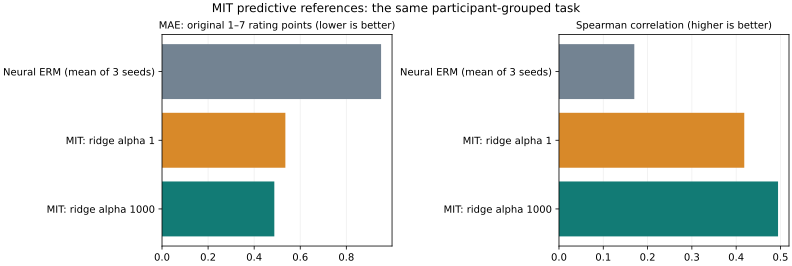

# Evaluating Fairness in Automated Video Interview Assessment

[](https://github.com/DEEPA-SI/Evaluating-Fairnes-in-Automated-Video-Interview-Assessment/actions/workflows/ci.yml)

Research code and aggregate evidence for Deepa Singh's Master of Applied Technologies
thesis at Unitec Institute of Technology.

Interview models can predict human ratings from visual, audio and language features.
This study asks whether making predictions more similar across automatically learned
groups also improves outcomes for separately audited groups, and what happens to
prediction accuracy along the way.

## Research contributions

- **Separate balancing from the penalty.** Each visual- or audio-group
  Wasserstein-1 (W1) penalty has a task-only control with the same group exposure.
  This distinguishes the added penalty from changes caused by balancing alone.
- **Check what label-free groups represent.** On MIT Interview, the visual clusters
  match one observer's perceived-gender partition exactly, despite excluding those
  annotations during construction. The audit examines perceived presentation, not
  demographic identity.
- **Connect alignment with prediction and group errors.** Held-out proxy checks and
  separate attribute audits show why a smaller score-distribution gap can accompany
  different accuracy consequences for different groups.
- **Test a stronger reference and another interview setting.** The complete MIT grid
  is evaluated at ridge coefficients 1 and 1000. AVI-Personality provides an
  independent participant sample with recruiter ratings and self-reported gender.

## Main findings

| Task-only reference | Evaluation | MAE | Spearman correlation |
|---|---|---:|---:|
| MIT Interview, ridge alpha 1 | Pooled participant-grouped out-of-fold predictions | 0.089, normalised scale | 0.418 |
| MIT Interview, ridge alpha 1000 | Same pooled participant-grouped evaluation | 0.081, normalised scale | 0.495 |
| AVI-Personality | Official 130-person test split | 0.419, original 1–5 scale | 0.473 |

The stronger MIT reference improves prediction descriptively, while the W1 penalty
continues to change held-out proxy-score distributions. Audited gains depend on the
attribute and exposure policy rather than following uniformly from proxy alignment.
All 15 configurations in each of the three grids are retained, including adverse
outcomes and finite fits without reported convergence.



The results are exploratory. Intervals are pointwise participant-bootstrap summaries
conditional on the fitted models. MIT's primary audit uses 69 post-session
participants and a separate 57-person pre-session sensitivity, with perceived
attributes supplied by one observer and skin tone retained on its ordinal 1–5 scale.
AVI's primary model convergence remains unknown. The study evaluates interview-rating
models; it does not establish universal fairness improvement or hiring validity.

See the [research overview](docs/research-overview.md) for the design, metric meanings
and interpretation, and the [result index](results/README.md) for the complete evidence.

## Install and reproduce the public reports

Use Python 3.11:

```bash
git clone https://github.com/DEEPA-SI/Evaluating-Fairnes-in-Automated-Video-Interview-Assessment.git
cd Evaluating-Fairnes-in-Automated-Video-Interview-Assessment
python3.11 -m venv .venv
source .venv/bin/activate
python -m pip install -r requirements.lock
python -m pip install --no-deps -e .
make verify
make reproduce
```

On Windows PowerShell, activate with `.venv\Scripts\Activate.ps1`. The report
generator can also be called directly with
`python -m src.publication --output-dir build/reproduction`.

`make reproduce` regenerates tables and figures from the included aggregate results
into `build/reproduction/`. It requires no video, model weights, private data or TeX.
It **does not** retrain models or recalculate participant-bootstrap intervals.
For a fresh output directory, use:

```bash
make reproduce OUTPUT_DIR=build/reproduction_02
```

`make all` runs package verification and aggregate report generation. The
[reproduction guide](docs/reproduction.md) explains the commands and outputs,
including the complete 45-row grid, primary matched contrasts and source receipt.

## Software checks

```bash
make test
make lint
```

These check the numerical methods and public reporting package. Source-data-dependent
fitting and auditing are separate routes for users with the required inputs; they
are not prerequisites for the public reporting workflow.

## Repository guide

| Location | Contents |
|---|---|
| [Research overview](docs/research-overview.md) | Research question, design, findings and metric interpretation |
| [Reproduction guide](docs/reproduction.md) | Public commands and the distinction between report regeneration and new fitting |
| [Data guide](data/README.md) | Dataset sources, input requirements and representation boundaries |
| [Results](results/README.md) | Complete frozen aggregate evidence and generated reports |
| `src/` | Numerical comparisons, aggregate reporting and optional source-data-dependent extraction/training |
| `tests/` | Numerical and publication-package tests |
| [Attribution](NOTICE.md) | Method, model and data-source acknowledgements |

Raw media, transcripts, face crops, embeddings, participant-level predictions and
individual attribute annotations are not redistributed here.

## Citation and attribution

Use GitHub's **Cite this repository** button or [CITATION.cff](CITATION.cff).
The thesis author is Deepa Singh; the supervisor is Ali Keivanmarz and the
co-supervisor is Professor Hamid Sharifzadeh.

```bibtex
@mastersthesis{singh2026interview_fairness,
  title  = {Evaluating Fairness in Automated Video Interview Assessment},
  author = {Singh, Deepa},
  school = {Unitec Institute of Technology},
  year   = {2026},
  type   = {Master of Applied Technologies thesis}
}
```

See [LICENSE](LICENSE) for the project software licence and [NOTICE.md](NOTICE.md)
for third-party attribution. The project licence does not replace dataset or
pretrained-model terms.
