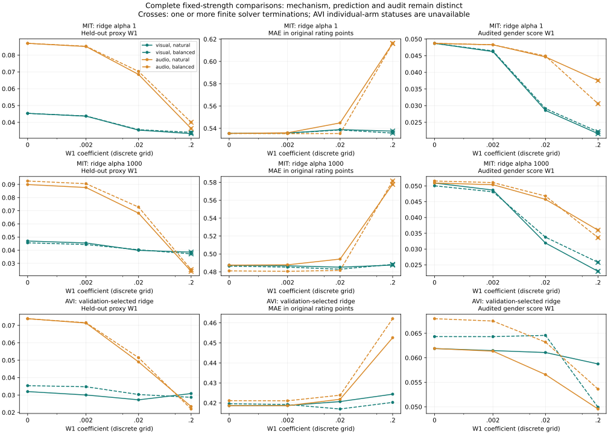

# Research overview

## The question

An interview-rating model learns to predict a human judgement from recorded
appearance, voice or language. A fairness intervention can bring two groups'
predicted scores closer together without making assessment more accurate for both
groups. This study examines that relationship through controlled comparisons of
prediction quality, learned-group score alignment and separately measured group
outcomes.

The intervention penalises Wasserstein-1 (W1) distance between score distributions
of groups learned from visual or audio features. Ordinary fitting and group
construction exclude the audit attributes. Those attributes are joined separately
to evaluate fixed predictions.

## Study design

| Setting | Prediction target and inputs | Evaluation and group measurement |
|---|---|---|
| MIT Interview | Crowd-perceived hireability on a 1–7 scale; candidate-face, mixed-speaker interview-audio and candidate-transcript representations | 138 sessions from 69 participants; participant-grouped cross-fitting; one observer's session-level perceived attributes |
| Stronger-ridge MIT sensitivity | Same targets, features, folds and proxy procedure, fixing ridge alpha at the previously development-selected value 1000 | Same controlled grid and phase-aligned audits, reported separately from the original alpha-1 comparison |
| AVI-Personality | Recruiter-rated interview performance on a 1–5 scale; full-frame visual and clip-audio features pooled over six responses | Official participant roles with 130 test participants; self-reported gender for the separate audit |

Frozen DINOv2, WavLM and MPNet representations support the MIT comparison.
AVI uses the visual and audio paths without a transcript branch. MIT candidate-face
crops and AVI full-frame video have different input boundaries, and interview audio
does not isolate the candidate's voice from the wider interaction.

Each compact grid contains 15 configurations: natural task-only prediction,
visual- and audio-balanced task-only controls, and W1 strengths 0.002, 0.02 and 0.2
under natural and balanced exposure for both proxies. The complete grids are
reported, not a best setting chosen from the audit.

Natural and balanced exposure each have their own zero-penalty control. Comparing
W1 with that matched control isolates the added penalty within the specified
predictor. It does not confuse the effect of score alignment with changing how
groups contribute to task fitting.

## What the results contribute

### Prediction provides the reference

On MIT, the original alpha-1 task-only reference gives pooled Spearman correlation
0.418 and normalised mean absolute error (MAE) 0.089. The stronger alpha-1000
reference gives pooled correlation 0.495 and normalised MAE 0.081. Their original
rating-scale MAEs are 0.535 and 0.487, respectively. These are descriptive
comparisons of pooled held-out predictions, not paired significance tests of
ridge coefficients.

The previously reported selected-model mean-fold correlation is a different
aggregation from the pooled correlations above. A mean of fold correlations
must not be substituted for a correlation calculated from concatenated predictions.

AVI's task-only compact reference gives test MAE 0.419 on its original 1–5 scale
and Spearman correlation 0.473. MIT and AVI predict different assessment sources;
normalising a scale does not make their constructs interchangeable.

### Label exclusion does not imply absence of group information

MIT's visual clusters reproduce the observer's perceived-gender partition exactly
across the participant rotations even though those annotations are excluded from
group construction. This concerns one observer's perceived presentation in these
recordings, not the participants' demographic identities.

Consequently, the visual proxy and that audit grouping do not represent unrelated
partitions. Their reported score distances can nevertheless differ because the
proxy check averages fold-local distances over both sessions, while the primary
audit pools phase-matched post-session scores.

### Proxy response and audited consequences need separate checks

In the original MIT natural-exposure visual comparison at strength 0.02, mean
held-out proxy W1 falls from 0.045 to 0.035. The perceived-gender audit gain has
a favourable point estimate but an interval spanning zero. Group-error analysis
shows a small accuracy improvement for one presentation group and a deterioration
for the other.

Under stronger ridge, mean held-out visual W1 falls from 0.047 to 0.040, and audio
W1 from 0.090 to 0.068, at the same natural-exposure strength. The alignment response
therefore also appears on the stronger predictive reference. Positive pointwise
post-session audit ranges occur for visual-balanced gender presentation and
audio-natural skin tone; the other primary post-session ranges include zero.
The resulting pattern depends on attribute and exposure policy rather than showing
a uniform audited gain.

The AVI primary visual comparison likewise gives small, uncertain changes in
prediction and gender-score disparity. Its primary model's convergence cannot be
identified from the retained overall solver counts. Finite outputs remain in the
complete grid with that qualification.

The figure keeps prediction error, learned-group response and audited gender-score
distance separate. Read each penalty against its own zero-penalty exposure control.
It displays the recorded estimates, not additional model fitting or new inference.

## Reading the metrics

| Quantity | Meaning and favourable direction |
|---|---|
| MAE | Absolute error against the supplied rating; lower is better for that prediction task |
| Spearman correlation | Agreement in ranking; higher is better, but it does not establish accurate score levels |
| Proxy W1 | Score-distribution distance between training-fitted visual or audio groups; a lower value shows alignment of those groups |
| Audited W1 | Maximum pairwise score distance among eligible categories of one separately measured audit axis |
| Disparity gain | Matched control distance minus penalty distance; positive means lower audited score disparity |
| Utility change | Penalty minus matched control; negative MAE change and positive correlation change favour prediction |

MIT errors in the compact aggregates use the normalised 0–1 rating scale. Multiply
by six to express them in original 1–7 rating points. AVI error tables use the
original 1–5 rating scale where indicated. Audited W1 and disparity gains use
normalised predicted-score units. The source result files and generated column
names state the unit for each quantity.

Clusters are fitted within training roles. Their numerical identifiers do not
establish a shared identity across folds; the proxy mechanism is evaluated within
each fold before averaging. Scores, category definitions, phase and aggregation
all matter when comparing proxy and audited distances.

## Audit and uncertainty scope

MIT's primary audit contains 69 post-session participants. The separate pre-session
sensitivity contains 57 available annotations. Perceived gender presentation,
racialised appearance and skin tone come from one observer. Skin tone retains its
ordinal 1–5 categories; it is not dichotomised or treated as an equal-interval
physical measurement. Categories below the ten-person reporting threshold retain
their counts without being merged into another group.

AVI's official test contains 130 people. The male/female audit uses 129 supported
self-reports; the remaining participant still contributes to overall utility.
These measurements differ from MIT's image-based perceptions.

Reported intervals use paired participant resampling with fitted predictions held
fixed. They describe evaluation-roster variation, not variation from retraining,
model selection or another observer. They are exploratory, pointwise intervals,
not simultaneous guarantees across the full set of comparisons. Small endpoints
retain their sign rather than being rounded to a misleading zero.

The MIT compact comparisons and AVI follow-up were informed by earlier inspected
evidence. Their contribution is a controlled account of the specified models and
audits, not an independent confirmatory test or a claim of validated hiring fairness.

## What the public commands reproduce

`make verify` checks the public package. `make reproduce` reads the frozen aggregates
and regenerates the complete grids, matched-contrast tables, overview and figures.
`make test` checks the numerical and reporting implementation. None of these public
report-generation steps recreates participant-level predictions or recalculates the
published bootstrap intervals.

Numerical fitting methods and optional original extraction and neural-training tools
are included for source-data-dependent use. A new training or audit calculation
requires the corresponding representations, participant roles, targets and attribute
inputs described in the [data guide](../data/README.md). These optional routes are
separate from the CPU-only aggregate reporting workflow.
See the [reproduction guide](reproduction.md) and [result index](../results/README.md)
for the exact commands and evidence files.
